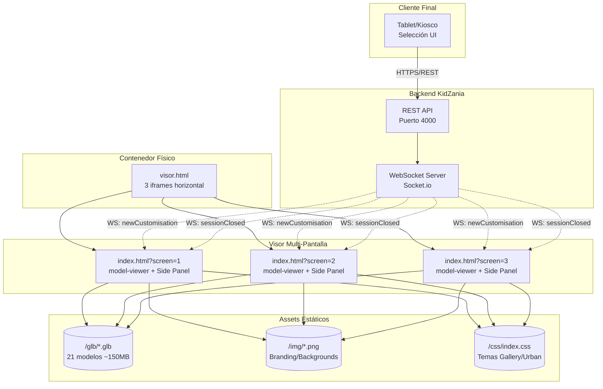

# Visor 3D - Adidas x KidZania

Documentación técnica del sistema de visualización 3D interactivo para la experiencia de personalización de prendas Adidas en KidZania.

---

## 1. Resumen Ejecutivo

**Visor 3D** es una aplicación web de visualización en tiempo real diseñada para la activación **Adidas x KidZania**. El sistema recibe eventos de personalización desde un backend central vía WebSocket y renderiza modelos 3D interactivos (GLB/glTF) en una configuración **tri-panel** (tres pantallas sincronizadas) mediante iframes.

### Propósito
- Mostrar customizaciones de prendas (playeras, sudaderas, pantalones, gorras) seleccionadas por niños en tablets/kioscos
- Renderizar modelos 3D con variantes de color, emblema y textura en tiempo real
- Sincronizar hasta 3 pantallas gigantes simultáneamente para experiencia inmersiva

### Problema que resuelve
Eliminar la latencia entre la selección del usuario y la visualización 3D en pantalla grande, proporcionando retroalimentación visual inmediata mediante comunicación WebSocket bidireccional y renderizado GPU acelerado via `<model-viewer>` (Three.js).

---

## 2. Arquitectura del Sistema

### Estilo Arquitectónico: **Cliente Ligero Event-Driven / Multi-View**

| Característica | Decisión | Justificación |
|----------------|----------|---------------|
| **Patrón** | Event-Driven + Observer | WebSocket push desde backend; UI reacciona a eventos `newCustomisation` / `sessionClosed` |
| **Despliegue** | Estático (HTML/CSS/JS vanilla) | Sin build step; deploy simple en cualquier servidor HTTP + WebSocket server externo |
| **Renderizado** | `<model-viewer>` Web Component | Abstrae Three.js/WebGL; soporta variantes GLB nativas (KHR_materials_variants), auto-rotate, camera-controls |
| **Multi-pantalla** | `visor.html` con 3 iframes | Aislamiento de contexto por pantalla; parámetro `?screen=1\|2\|3` filtra eventos |

> **Por qué no SPA/Framework:** Requisito de carga ultra-rápida en hardware limitado (kioscos KidZania), cero dependencias npm, compatibilidad garantizada en navegadores embebidos/señalética digital.

### Flujo de Datos

```
┌─────────────┐     HTTP/REST      ┌──────────────┐     WebSocket      ┌────────────────────────┐
│  Tablet/    │ ─────────────────► │  Backend     │ ─────────────────► │  3x index.html         │
│  Kiosco     │   Selección UI     │  (Puerto     │   newCustomisation │  ?screen=1,2,3         │
│  (Usuario)  │                    │   4000)      │   sessionClosed    │  (model-viewer + UI)   │
└─────────────┘                    └──────────────┘                    └────────────────────────┘
                                                                                  │
                                                                                  ▼
                                                                        ┌────────────────────────┐
                                                                        │  visor.html (contenedor)│
                                                                        │  3 iframes side-by-side │
                                                                        └────────────────────────┘
```

**Paso a paso:**

1. **Registro/Inicio**: Usuario escanea QR o ingresa en tablet → Backend crea sesión → Envía `screen` asignado
2. **Selección Línea/Prenda**: UI tablet envía `product_type` + `product_id` → Backend valida stock/variantes
3. **Personalización**: Usuario elige color/emblema/textura → Backend compila array `personalization: ["var_color_rojo", "var_emb_01", "var_texture_02"]`
4. **Proyección 3D**: Backend emite `newCustomisation` por WebSocket → Cada `index.html` filtra por su `screen` → `model-viewer` carga GLB + aplica variantes → Side panel actualiza info-card

### Diagrama de Arquitectura (Mermaid.js)



---

## 3. Stack Tecnológico y Herramientas

### Frontend

| Capa | Tecnología | Versión | Justificación |
|------|------------|---------|---------------|
| **Core 3D** | `<model-viewer>` (Google) | 3.4.0 | Web Component estándar; soporta GLB variants, AR, auto-rotate, lazy-load, poster; cero config Three.js |
| **Comunicación** | Socket.io Client | 4.7.5 | Reconexión automática, rooms/namespaces, fallback polling; CDN ready |
| **Estilos** | CSS Vanilla + Custom Properties | — | Sin build; temas (Gallery/Urban) via CSS vars; responsive con clamp() y media queries |
| **Fuentes** | Adineue Pro (Adidas) | — | Brand compliance; fallback Helvetica/sans-serif |
| **Entrada** | ES Modules nativo | — | `type="module"` en `<script>` para imports futuros |

### Backend (Externo - No Incluido)

| Componente | Tecnología | Puerto |
|------------|------------|--------|
| **API REST** | Node.js/Express (asumido) | 4000 |
| **WebSocket** | Socket.io Server | 4000 (mismo) |
| **Auth** | Token por pantalla (pendiente) | — |

### Assets 3D

| Formato | Especificación | Detalle |
|---------|----------------|---------|
| **Modelos** | GLB (glTF Binary) | 21 archivos, variantes KHR_materials_variants embebidas |
| **Variantes** | `var_color_*`, `var_emb_*`, `var_texture_*` | Seleccionadas via `model-viewer.variantName` |
| **Compresión** | **Ninguna (crítico)** | Sin Draco, texturas sin optimizar WebP/AVIF |

### Entorno de Ejecución

| Requisito | Especificación |
|-----------|----------------|
| **Navegador** | Chrome/Edge 100+ / Firefox 95+ / Safari 15+ |
| **WebGL** | WebGL2 obligatorio |
| **Red** | LAN local; WebSocket `ws://localhost:4000` (configurable via `?api_port=`) |
| **Hardware** | GPU dedicada recomendada (modelos 5-15MB c/u) |

---

## 4. Componentes Clave y Módulos

### 4.1 `index.html` — Visor Principal (Single-Screen)

**Responsabilidad:** Renderizado 3D + Side Panel UI + WebSocket Client

| Módulo/Función | Línea | Descripción |
|----------------|-------|-------------|
| `construirSrcModelo(productId)` | 100-116 | Resuelve ruta `./glb/{id}.glb` normalizando inputs |
| `obtenerProductId(data)` | 118-131 | Extrae `product_id` de múltiples paths en payload (defensa en profundidad) |
| `cargarModelo(productId)` | 137-183 | Carga GLB en `model-viewer` con transiciones CSS (fade/scale) + Promise-based load detection |
| `aplicarVariante(nombre)` | 197-206 | Aplica variante GLB via `modelViewer.variantName` con transición visual |
| `extraerUltimaParte(valor)` | 185-195 | Parsing: `"var_color_rojo"` → `"rojo"` |
| `socket.on('newCustomisation')` | 240-292 | Handler principal: orquesta carga modelo + actualiza info-card + aplica variantes secuenciales |
| `socket.on('sessionClosed')` | 294-309 | Reset UI + vuelve a imagen idle |

**Estados del Visor (State Machine Implícita):**
```
IDLE (imagen estática) 
  → LOADING_IMAGE (4s showing initial-image)
  → LOADING_MODEL (fetch GLB + parse, ~3-8s)
  → ACTIVE (modelo visible, min 25s)
  → CLOSING (sessionClosed)
  → IDLE
```

### 4.2 `visor.html` — Contenedor Tri-Panel

**Responsabilidad:** Layout horizontal 3 iframes a pantalla completa

```html
<iframe src="index.html?screen=1" allowfullscreen></iframe>
<iframe src="index.html?screen=2" allowfullscreen></iframe>
<iframe src="index.html?screen=3" allowfullscreen></iframe>
```

- Cada iframe aisla: WebSocket connection, `model-viewer` instance, DOM state
- Parámetro `screen` filtra eventos en cliente (línea 243: `data.screen === screen`)

### 4.3 `css/index.css` — Sistema de Temas y Layout

| Tema | Clase Body | Background |
|------|------------|------------|
| **Gallery Lab** | `.gallery-lab` | Gradient gris neutro (CSS var `--bg-gallery`) |
| **Urban Creator** | `.urban-creator` | Imagen `fondo.png` cover (1.9MB) |

**Responsive Breakpoints:**
- `@media (max-width: 600px)`: Layout columna, side-panel horizontal
- `@media (max-width: 400px)`: Side-panel vertical compacto

**Animaciones Clave:**
- `.initial-image.hidden/showing`: Opacity 2s ease + visibility
- `.model-switching`: Scale 0.95 → 1.0 + fade 0.4s cubic-bezier
- `.variant-switching`: Opacity 0.7 → 1.0 en 150ms

### 4.4 Modelos GLB (`/glb/`)

| Línea | Tipo | Variantes | Archivos |
|-------|------|-----------|----------|
| `dep` (Deportiva) | Playera | 01, 02, 03 | 3 |
| `dep` | Sudadera | 01, 02, 03 | 4 (incluye `_ok`) |
| `dep` | Pantalón | 01, 02, 03 | 3 |
| `dep` | Gorra | 01, 02 | 2 |
| `mod` (Moderna) | Playera | 01, 02, 03 | 3 |
| `mod` | Sudadera | 01, 02, 03 | 3 |
| `originals` | Playera | 02 | 1 |
| **Total** | | | **21 archivos ~150MB** |

**Convención naming:** `prd_{linea}_{tipo}_{variante}.glb`

---

## 5. Consideraciones de Seguridad y Escalabilidad

### 5.1 Seguridad

| Vector | Estado Actual | Riesgo | Mitigación Recomendada |
|--------|---------------|--------|------------------------|
| **XSS via `user_name`** | `innerText` usado correctamente | 🟢 Bajo | Mantener `textContent`; nunca `innerHTML` |
| **WebSocket sin auth** | Cualquiera conecta a `ws://localhost:4000` | 🔴 Crítico | Token por pantalla en `query` + validación `origin` en server |
| **Puerto expuesto** | 4000 en LAN sin firewall | 🟠 Alto | Restringir IP; VPN; mTLS en producción |
| **CSP ausente** | Sin Content-Security-Policy | 🟠 Alto | Agregar meta tag CSP (ver abajo) |
| **HTTPS no enforzado** | CDN cargan HTTP en dev | 🟡 Medio | HTTPS obligatorio en prod; HSTS |
| **Validación payload** | Solo `typeof string` checks | 🟡 Medio | Schema validation (Zod/JSON Schema) en backend |

**CSP Recomendado:**
```html
<meta http-equiv="Content-Security-Policy"
  content="default-src 'self';
           script-src 'self' https://ajax.googleapis.com https://cdn.socket.io;
           style-src 'self' 'unsafe-inline';
           img-src 'self' data: https:;
           connect-src 'self' ws://localhost:4000 wss://*.kidzania.com;
           model-src 'self';">
```

### 5.2 Escalabilidad y Rendimiento

| Métrica Actual | Objetivo | Acción |
|----------------|----------|--------|
| **Tamaño GLB** | 5-15MB c/u | 🔴 **Draco compression + WebP textures** (target 60-80% reducción) |
| **First Paint** | ~2-4s | Precarga modelos probables (`<link rel="preload" as="model">`) |
| **Model Load** | ~6-10s | Service Worker cache + lazy-load diferido |
| **Memoria GPU** | 200-400MB | Dispose models no usados; `model-viewer` no expone unload nativo → requiere workaround |
| **Concurrencia** | 3 pantallas | OK actual; >3 requiere backend sharding |

**Arquitectura para Crecimiento:**

```
┌─────────────────────────────────────────────────────────────┐
│                    ESCALABILIDAD HORIZONTAL                  │
├─────────────────────────────────────────────────────────────┤
│                                                              │
│  ┌──────────┐    ┌──────────┐    ┌──────────┐              │
│  │ WS Node 1│    │ WS Node 2│    │ WS Node N│  (Redis Pub/Sub)│
│  │ Screen 1-3│   │ Screen 4-6│   │ Screen 7-9│              │
│  └────┬─────┘    └────┬─────┘    └────┬─────┘              │
│       │               │               │                     │
│       └───────────────┼───────────────┘                     │
│                       ▼                                     │
│              ┌────────────────┐                             │
│              │  Load Balancer │                             │
│              │  (NGINX/HAProxy)│                            │
│              └────────────────┘                             │
│                                                              │
└─────────────────────────────────────────────────────────────┘
```

### 5.3 Observabilidad (Pendiente)

| Métrica | Implementación Sugerida |
|---------|-------------------------|
| `model_load_time` | `performance.now()` antes/después `cargarModelo()` |
| `variant_switch_latency` | Timestamp en `aplicarVariante()` |
| `session_duration` | `sessionClosed` - `newCustomisation` |
| `websocket_reconnects` | Socket.io `reconnect` event counter |
| `error_rate` | Try/catch logging → endpoint telemetría |

---

## 6. Guía Rápida de Desarrollo

### Ejecución Local

```bash
# 1. Servidor estático (puerto 8080)
npx serve . -p 8080

# 2. WebSocket server (puerto 4000) - REQUERIDO
# Ver implementación backend separada

# 3. Abrir visor tri-panel
# http://localhost:8080/visor.html

# 4. Abrir pantalla individual
# http://localhost:8080/index.html?screen=1&api_port=4000
```

### Parámetros URL

| Parámetro | Default | Descripción |
|-----------|---------|-------------|
| `screen` | `"1"` | Identificador pantalla (1, 2, 3) |
| `api_port` | `"4000"` | Puerto WebSocket server |

### Testing Manual

```javascript
// En consola del navegador (index.html)
// Simular evento newCustomisation
socket.emit('newCustomisation', {
  screen: '1',
  user_name: 'Test Kid',
  product_type: 'Playera',
  product_id: 'prd_dep_playera_01',
  personalization: ['var_color_rojo', 'var_emb_01', 'var_texture_01']
});

// Simular cierre sesión
socket.emit('sessionClosed', { screen: '1' });
```

---

## 7. Roadmap Técnico Priorizado

| Prioridad | Iniciativa | Esfuerzo | Impacto |
|-----------|------------|----------|---------|
| **Crítico** | Optimización GLB (Draco + WebP) | 1 semana | -70% tamaño, -50% load time |
| **Crítico** | Auth WebSocket + CSP | 3 días | Seguridad producción |
| **Alto** | Modularización (HTML/CSS/JS separados) | 2 semanas | Mantenibilidad, caching, CI/CD |
| **Alto** | Precarga inteligente + Service Worker | 1 semana | UX instantánea |
| **Medio** | TypeScript + ESLint + Tests (Vitest/Playwright) | 2 semanas | Calidad, regresiones |
| **Medio** | State Machine formal + Config JSON | 3 días | Robustez, cero magic numbers |
| **Bajo** | PWA / AR mode / Admin Dashboard | 4+ semanas | Diferenciación |

---

## 8. Referencias

- [`<model-viewer>` Docs](https://modelviewer.dev/)
- [Socket.io Client API](https://socket.io/docs/v4/client-api/)
- [glTF Transform CLI](https://gltf-transform.donmccurdy.com/) — Optimización GLB
- [WebGL Best Practices](https://web.dev/webgl-best-practices/)
- [Content Security Policy](https://developer.mozilla.org/en-US/docs/Web/HTTP/CSP)

---

*Documentación v1.0 — Generada 2026-07-27 — Enrique Daniel Trejo Valdez*